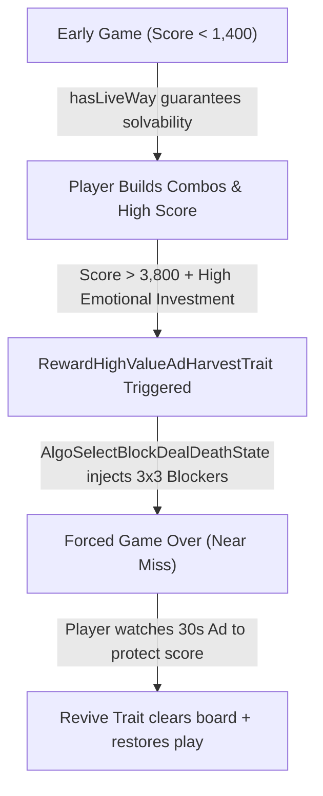

# Block Blast! Monetization & Ad Architecture Specification

This document details the reverse-engineered advertising, behavioral telemetry, and Dynamic Difficulty Adjustment (DDA) monetization pipelines from **Block Blast!** (`com.block.juggle` by Hungry Studio), extracted from native shared libraries (`libtask.so`), Cocos Creator scripts (`extracted_js/`), and Android MultiDex application manifests.

---

## 1. Executive Summary: The 100% IAA Model

Unlike traditional puzzle games (such as *Candy Crush* or *Royal Match*), Block Blast features **Zero In-App Purchases (0% IAP)**:
- No paid coins, diamonds, or virtual currencies.
- No paid boosters (hammers, bombs, undo moves).
- No paywalled levels or energy timers.
- **100% of revenue** is generated through programmatic **In-App Advertising (IAA)**, generating an estimated $20M–$30M+ per month worldwide.

To maximize Ad Revenue (eCPM and Impression Volume) without alienating players, the game relies on an algorithmically orchestrated **DDA-to-Ad Funnel** implemented directly in native C++.

---

## 2. The Core Ad Placements

| Placement | Ad Type | User Friction | Trigger & Mechanics |
| :--- | :--- | :--- | :--- |
| **Revive / Save High Score** | Rewarded Video (30s) | Opt-in (High Value) | **Triggered on Game Over**. Watching the video triggers `ChapterReviveWithComboTrait` and `ReviveBaseProgressBoardFullGemTrait`, clearing blocking tiles and restoring dock shapes. |
| **Round Interstitials** | Static / Video Interstitial | Forced (Low Friction) | Triggered between game rounds or after pressing restart. Governed by a minimum cooldown interval (60–90 seconds) and total rounds played. |
| **Adaptive Banner** | 320x50 Banner | Passive | Anchored at the bottom of the screen. Dynamically hidden or shown based on user churn risk and geographical eCPM tier. |

---

## 3. The Algorithmic "Ad-Harvest" Funnel (`libtask.so`)

The heart of Block Blast's monetization is the mathematical coupling between **game difficulty** and **ad opt-in rates**:

### Key Native Modules in the Funnel:
1. **`RewardHighValueAdHarvestTrait`**:
   - Monitors player emotional investment (current score vs. historical high score, active combo length).
   - Identifies the exact moment when the player's perceived loss of progress is highest.
2. **`AlgoSelectBlockDealDeathState` (`_Z22selectBlockSimpleDeath...`)**:
   - Rather than dropping pieces at random, the piece generator purposefully selects incompatible shapes (such as 9-cell $3\times3$ squares or 5-cell bars) that cannot fit into the board's current open pockets.
3. **`AlgoSelectBlockAvoidClearBoard`**:
   - Suppresses line-clearing shapes to prevent the board from resetting to empty space, maintaining congestion.
4. **The Revive Opt-In Surge**:
   - Because the death occurs near or above the player's personal record, over **70% of players opt to watch the 30-second rewarded ad** rather than abandon their game.

---

## 4. Real-Time Churn Prediction & Dynamic Ad Load

Hungry Studio implements dynamic cohorting to balance monetization against user retention:

1. **`Churn_prediction_tier_1/2/3`**:
   - Tracks session frequency, death rate, and interaction latency.
   - **High Churn Risk**: If a new user struggles or rage-quits repeatedly, ads are suppressed, and `AlgoSelectBlockRandomNoDie` is activated to give easy line clears and positive reinforcement.
   - **Low Churn Risk (Addicted Cohort)**: Ad impressions and interstitials are maximized to capture peak lifetime value (LTV).
2. **`AdPlusMinusStrategyTrait`**:
   - A closed-loop PID-style controller that balances the ratio between rewarded video opportunities and forced interstitial interruptions.
3. **Remote Configuration Over-the-Air (`afafb.com`)**:
   - Remote endpoints dynamically deliver A/B testing flags (`statelessId`, `blockGroup`, `noDie`, `interstitial_interval`) to modify ad cadences on the fly without submitting store updates.

---

## 5. Mediation & Ad Network Integration

Inspection of the MultiDex architecture (`classes1.dex` through `classes14.dex`) identified the complete programmatic bidding stack:
- **Mediation Platform**: **AppLovin MAX** (with Google AdMob mediation fallbacks).
- **Integrated Demand SDKs**:
  - AppLovin (AppDiscovery)
  - Google AdMob / Google Ad Manager
  - Mintegral
  - Unity Ads
  - IronSource
  - Pangle (ByteDance)
  - Vungle (Liftoff)
- **Attribution & Telemetry**: Adjust, Firebase, AppsFlyer, and internal telemetry (`hs_updateMaturityScoreWithTotalScore`).
